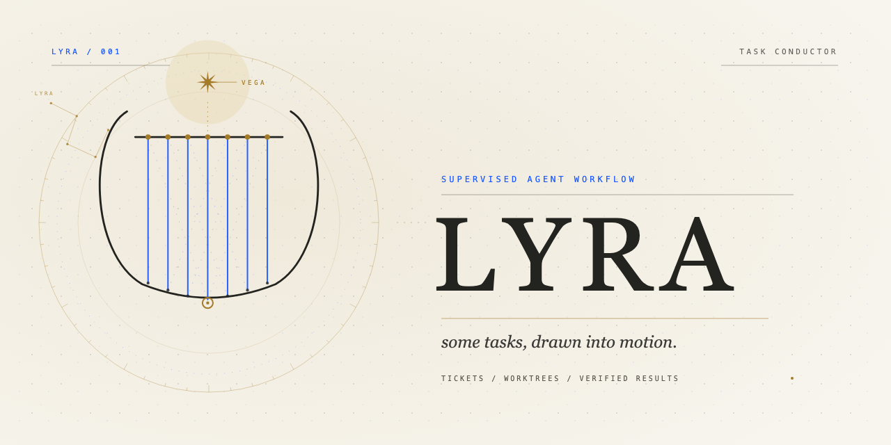
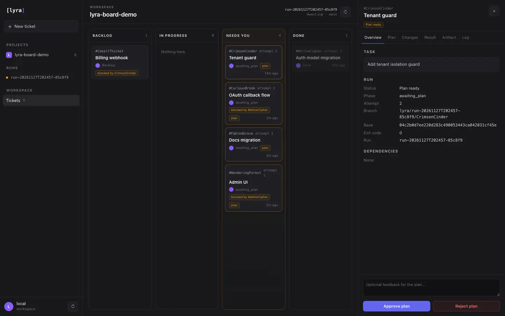

<p align="center">
  <picture>
    <source media="(prefers-color-scheme: dark)" srcset="assets/brand/banners/lyra-banner-nocturne.png">
    
  </picture>
</p>

Repository: <https://github.com/atom2ueki/lyra>

Lyra is a local task conductor for coding agents. It keeps the task graph in a local store,
runs each ready ticket in its own Git worktree, and exchanges results as files — not as a chat
transcript.

The 0.7 core is deliberately small:

- **Ticket DAG** — tickets, dependencies, claims, attempts, events.
- **Worktrees** — one isolated branch/worktree per ticket, safe parallel execution.
- **Generic process runner** — a worker is a command. No pane backend, no harness registry.
- **File contract** — `TASK.md`, `RESULT.md`, `worker.log`. Any agent CLI can be a worker.
- **Human gates** — optional plan gate, mandatory review gate, `approve` / `reject`, merge
  conflict detection, and feedback turns.
- **Local board** — `lyra serve` opens a Todos-style workspace with Backlog / In progress /
  Needs you / Done, ticket detail, plan/diff/result tabs, and gate buttons.

Tool-specific integrations are adapters, not core. OMP, Claude Code, Codex, or any other CLI is
selected by the project's worker command.

## Install

Release builds are macOS Apple Silicon and Linux (x86_64/arm64) binaries.

```sh
curl -fsSL https://raw.githubusercontent.com/atom2ueki/lyra/main/install.sh | sh
lyra --version
lyra upgrade
```

The installer uses `~/.local/bin` by default and verifies the release `SHA256SUMS` before replacing
the binary. Override with `LYRA_INSTALL_DIR`, pin a tag with `LYRA_VERSION=0.3.0`, or use
`LYRA_GITHUB_TOKEN` for a private fork (`gh` is required for authenticated asset downloads).

From source:

```sh
cd rust
cargo build --release
# binary is rust/target/release/lyra
cargo install --path .
```

`lyra upgrade` downloads the latest release asset for the current platform, verifies its checksum,
and atomically replaces the running binary. Use `lyra upgrade --check` to inspect the available
version, `--force` to reinstall the same version, or `--version 0.1.0` to pin a release.

## Usage

```sh
lyra init
lyra add "Add rate limiting to the login endpoint"
lyra tickets list --details
lyra tickets close QuietHarbor
lyra status
lyra start --max 2
lyra serve --open
lyra monitor --once
lyra approve QuietHarbor
lyra reject QuietHarbor --note "keep the old cookie fallback"
lyra wait --timeout-ms 30000
lyra report
lyra logs QuietHarbor
lyra close
```

`LYRA_HOME` overrides `~/.lyra` (stores and runs). The project config lives in `lyra.toml` at the
repository root:

```toml
[project]
base_ref = "main"
max_parallel = 2
max_seconds = 3600

[worker]
# The command runs inside the ticket's worktree. `{task}` is the generated
# TASK.md path; if omitted, Lyra appends it as the last argument.
build = ["omp", "--approval-mode", "yolo"]

# Optional environment for every worker:
# [worker.env]
# DATABASE_URL = "postgres://localhost/app"
```

New tickets use readable `AdjectiveNoun` ids such as `QuietHarbor`; legacy `T-001` ids from
imported stores remain valid.

## Local board

```sh
lyra serve --open
```

The board binds to `127.0.0.1:4321` by default (local only, no auth). It shows four columns:
Backlog, In progress, Needs you, and Done. Clicking a card opens the ticket detail with
Overview / Plan / Changes / Result / Artifact / Log tabs. Plan and review gates can be approved
or rejected directly in the detail panel; the background monitor advances running workers every
second. `New ticket` creates a ticket from the board.



## Worker contract

Each worker gets:

- a Git worktree on its own branch,
- `workers/<ticket>/TASK.md`,
- `workers/<ticket>/RESULT.md` as the result path,
- `workers/<ticket>/worker.log` for stdout/stderr,
- environment variables `LYRA_RUN_ID`, `LYRA_TICKET_ID`, `LYRA_TICKET_SUBJECT`,
  `LYRA_CLAIM_ID`, `LYRA_WORKTREE`, `LYRA_PROMPT_FILE`, `LYRA_RESULT_FILE`,
  `LYRA_PLAN_FILE`, `LYRA_DIFF_FILE`, `LYRA_PHASE`, and `LYRA_ATTEMPT`.

If `[worker].plan` is configured, the plan command runs first and writes `PLAN.md` plus
`RESULT.md`. The ticket parks at `AwaitingPlan`; `lyra approve <ticket>` starts the build,
`lyra reject <ticket> --note ...` re-runs the plan with feedback. If `plan` is omitted, the build
starts immediately.

The build command runs in the same worktree. When it reports `done`, Lyra writes `DIFF.patch` and
parks at `AwaitingReview`. `lyra approve <ticket>` merges the branch into the base branch (or
`--no-merge` marks it done without merging), and `lyra reject <ticket> --note ...` re-runs the
build with `FEEDBACK.md`. A merge is refused unless the base branch is checked out and clean; a
conflict aborts the merge and leaves the ticket at `AwaitingReview` with `phase: merge_conflict`.

A worker finishes by committing its work and writing:

```text
status: done|blocked|failed|needs_input
summary: <what changed, or what you need>
verification: <checks actually run>
blockers: <comma-separated ticket ids, blocked only>
```

`done` requires a clean worktree. `blocked` adds the named tickets as blockers and keeps the
worktree for resume. `needs_input` parks the ticket and keeps the worktree. `failed` is retried
up to 3 attempts in the same worktree.

Every worker run also writes `ARTIFACT.json` with `runId`, `ticketId`, `attempt`, `phase`,
`command`, `branch`, `baseHead`, `head`, `startedAt`, `finishedAt`, `exitCode`, `error`, and the
artifact paths (`PLAN.md`, `RESULT.md`, `DIFF.patch`, `worker.log`). Per-phase snapshots
live in `workers/<ticket>/artifacts/<phase>-<attempt>.json`.

The conductor owns the store, claims, attempt state, and worktrees. A worker never edits the
ticket store or another worktree.

## Architecture

```text
rust/src/
  schema.rs        ticket/run schema + validation
  store.rs         tickets, claims, events, retry requeue
  graph.rs         ready/blocked graph projections
  conductor.rs     scheduler, plan/review gates, merge, attempts, artifacts
  runner.rs        process spawn, status, SIGTERM/SIGKILL, logs
  worker.rs        TASK.md / RESULT.md / PLAN.md contract
  worktree.rs      isolated branches and cleanup
  project_config.rs  lyra.toml
  server.rs        local HTTP API + embedded board
  web/index.html   Todos-style board UI
  cli.rs           init/add/tickets/start/monitor/approve/reject/serve/wait/stop/report/logs/close
```

There is no pane backend, harness registry, model policy, OMP extension, or import adapter in the
core. Those were removed in the 0.7 refactor; a worker command is the integration point.

## Non-goals for 0.7 core

- Team / multi-user / auth
- Remote machines / cloud sandboxes
- OMP, Claude Code, Codex, or MCP adapters
- Model policy / provider usage routing

The design and research docs live in `~/.agents/plans/lyra.md` and
`~/.agents/plans/lyra-research.md`. The 0.7 simplification map and lifecycle animation live in
`docs/lyra-0.7-simplification.html` and `docs/lyra-0.7-lifecycle-demo.html`.
