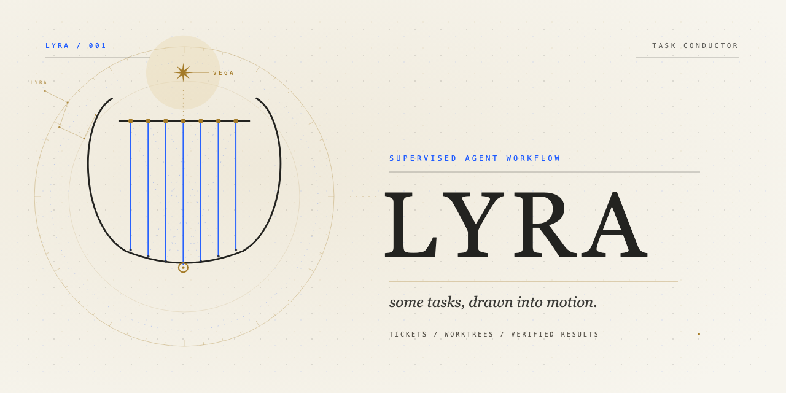

<p align="center">
  <picture>
    <source media="(prefers-color-scheme: dark)" srcset="assets/brand/banners/lyra-banner-nocturne.png">
    
  </picture>
</p>

Repository: <https://github.com/atom2ueki/lyra>

Lyra is a supervised task conductor for coding agents. It keeps the task graph in a local store,
schedules ready work into agent panes, and records results as files — not as a chat transcript.

The core scheduler, store, pane adapters, worktree handling, and model routing are **Rust**
(`rust/`). The only JavaScript is the OMP worker extension (`rust/src/lyra-worker.mjs`), which is
embedded into the Rust binary and loaded into each OMP worker with `-e`.

Implemented:

- Lyra ticket schema v1 + local store + DAG validation
- `omp-kanban` import adapter
- `lyra init` / `setup` / `import` / `status` / `graph` / `models` / `doctor`
- `PaneBackend`: herdr, Ghostty, headless — chosen by `LYRA_PANE_BACKEND`, then the
  `pane_backend` key in `config.toml` (written by `lyra setup`), then terminal detection.
  New terminals are added as `PaneBackend` implementations; there is no runtime plugin
  system by design.
- worker extension (`lyra_progress`, `lyra_discover`, `lyra_finish`)
- `lyra conduct start|monitor|resume|stop|report`, `lyra add`, `lyra logs`, `lyra close`
- run-scoped worktrees, claims, state/events
- blocker suspension/checkpoint/resume and `needs_input`
- model policy: classes, roles, provider caps, usage-aware selection, per-worker role overlay
- cross-agent launch (`omp`/`codex`/`claude`) with a `RESULT.md` fallback
- OMP adapter package (`packages/omp`) — six typed lead-agent tools plus the human `/lyra` command

No board UI, no native terminal. Those are non-goals for the current product.

## Install

Release builds are macOS Apple Silicon and Linux (x86_64/arm64) binaries.

```sh
curl -fsSL https://raw.githubusercontent.com/atom2ueki/lyra/main/install.sh | sh
lyra --version
lyra upgrade
```

The installer uses `~/.local/bin` by default and verifies the release `SHA256SUMS` before replacing
the binary. Override with `LYRA_INSTALL_DIR`, pin a tag with `LYRA_VERSION=0.3.0`, or use
`LYRA_GITHUB_TOKEN` for a private fork (`gh` is required for authenticated asset downloads).

From source:

```sh
cd rust
cargo build --release
# binary is rust/target/release/lyra
cargo install --path .
```

`lyra upgrade` downloads the latest release asset for the current platform, verifies its checksum,
and atomically replaces the running binary. Use `lyra upgrade --check` to inspect the available
version, `--force` to reinstall the same version, or `--version 0.1.0` to pin a release.

## Usage

```sh
lyra init
lyra import omp-kanban ~/Documents/atom2ueki/omp-kanban/.omp/kanban
lyra conduct status
lyra models
lyra graph --format mermaid
lyra tickets update QuietHarbor --prompt "new prompt" --priority 4 --json
lyra tickets update QuietHarbor --blocked-by SwiftFalcon --json
lyra conduct start --max 2
lyra conduct monitor
lyra conduct resume --run <run-id>
lyra report
lyra logs QuietHarbor
lyra close
```

`LYRA_HOME` overrides `~/.lyra`. Run `lyra setup` once per machine: it verifies omp/git,
resolves the pane backend, and persists it as `pane_backend` in `~/.lyra/config.toml`
(herdr and Ghostty give visible workers; headless runs them invisibly).
`LYRA_PANE_BACKEND=herdr|ghostty|headless` overrides config for one invocation;
`LYRA_OMP_BIN` overrides the `omp` binary for tests.

New tickets use readable `AdjectiveNoun` ids such as `QuietHarbor`; legacy `T-001` ids from
imported stores remain valid.

## Worker contract

Each worker gets a worktree, a `TASK.md` brief, a claim-scoped file channel, and a generated
`roles.yml` for OMP subagent routing. Workers report through the extension; non-OMP harnesses use
`RESULT.md` with these fields:

```text
status: done|blocked|failed|needs_input
summary: <what changed, or the question>
verification: <checks actually run>
blockers: <ticket ids discovered in this attempt>
```

The conductor owns `state.json`, tickets, claims, and worktrees. A worker never edits the ticket
store or another worktree.

## OMP adapter

```sh
omp plugin link ./packages/omp
```

The adapter exposes six typed tools to the lead agent — `lyra_status`, `lyra_tickets`
(list/show/read or update/write), `lyra_tickets_create`, `lyra_start`, `lyra_wait`, and
`lyra_control`. It shells out to the `lyra` binary and owns no state. Workers use the separate
`lyra-worker.mjs` extension and never call the CLI. `/lyra` remains a human/debug escape hatch.

The design and research docs live in `~/.agents/plans/lyra.md` and
`~/.agents/plans/lyra-research.md`.
